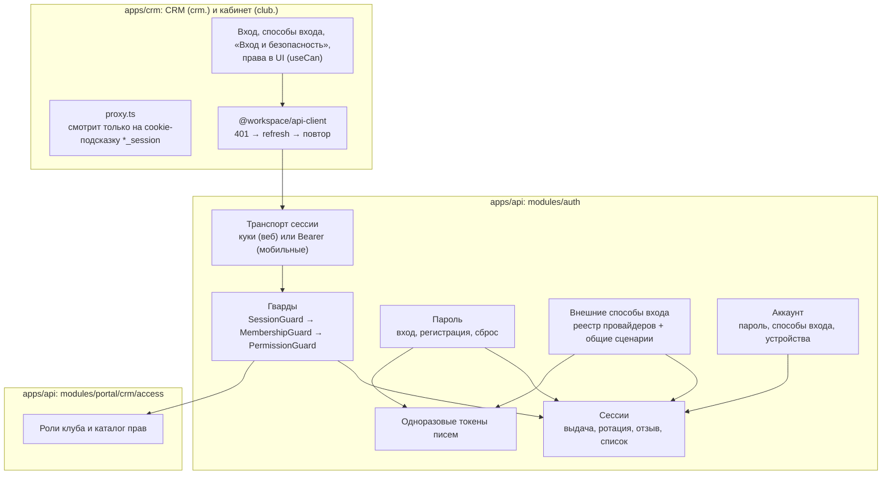
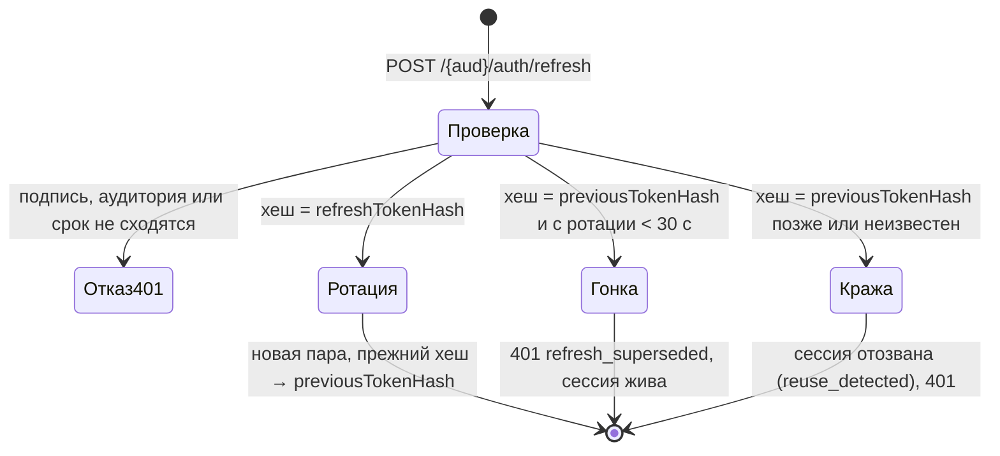
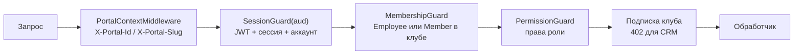
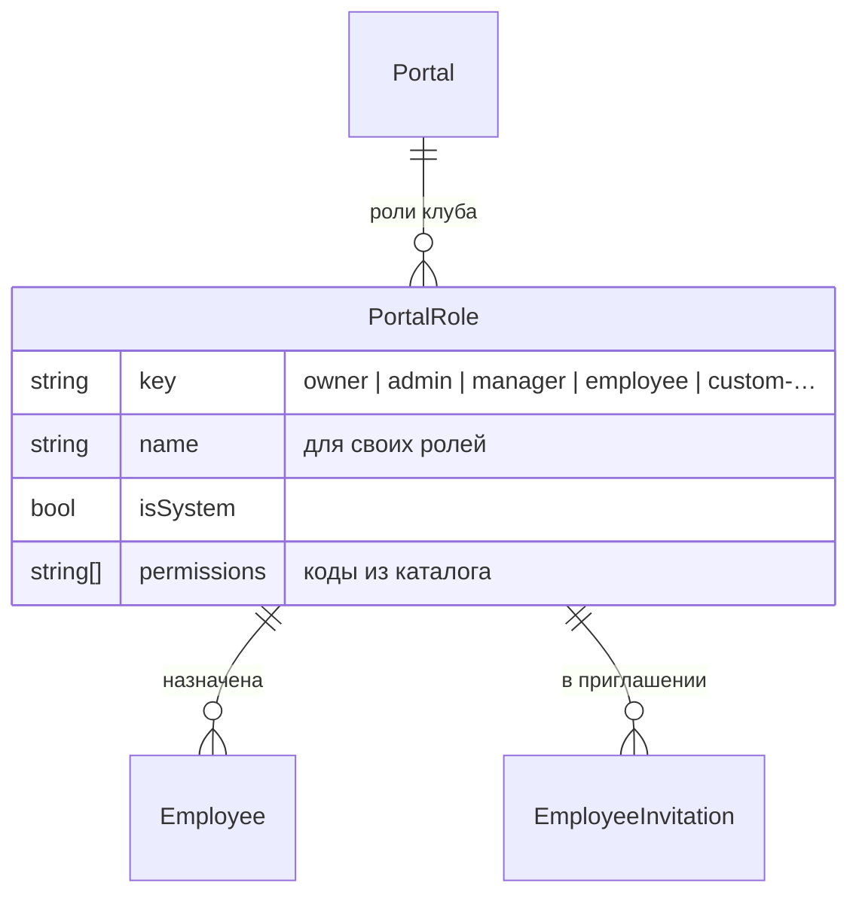
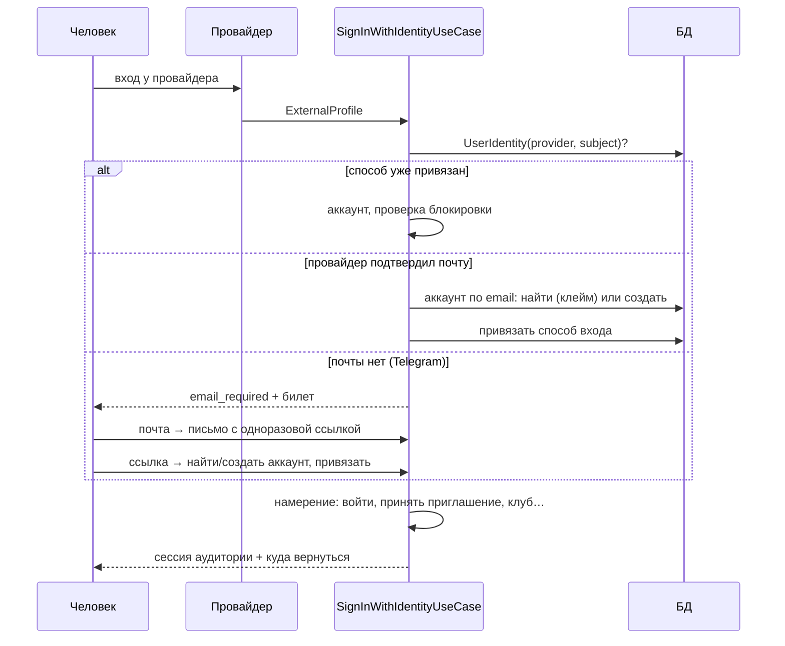

# Auth и права: целевая архитектура

Дата: 2026-10-17. План работ — [auth-platform](../tasks/auth-platform.md) (TASK-730…). Решение Вадима
(2026-10-17): «мы ещё в dev, обратная совместимость не нужна — делай сразу по уму, особенно auth; появились
Google и Telegram, может появиться ещё что-то — нужна нормальная архитектура». Существующие клубы и
участников при необходимости можно удалить; миграции пишем так, чтобы ничего не терять, если это дёшево.

Документ описывает, как устроено **после** перестройки. Что было до неё — разбор от 2026-10-17 в
[auth-platform](../tasks/auth-platform.md#как-было).

---

## 1. Термины

| Термин | Что это |
|---|---|
| **Аккаунт** (`User`) | Человек. Глобальный, без клуба: email, пароль (может не быть), статус |
| **Способ входа** | Пароль или внешний провайдер (`UserIdentity`: Google, Telegram, …) |
| **Аудитория** | Приложение, в которое человек входит: `crm` (сотрудник, `crm.`) или `cabinet` (участник, `club.`). У каждой свои куки и свои сессии: вход в CRM на компьютере клуба не открывает личный кабинет |
| **Сессия** (`AuthSession`) | Вход на одном устройстве в одну аудиторию. Её отзыв действует сразу, а не когда истечёт access-токен |
| **Членство** | Связь аккаунта с клубом: `Employee` (сотрудник) или `Member` (участник). Резолвится на каждый запрос по клубу из `X-Portal-*` |
| **Роль** (`PortalRole`) | Набор прав сотрудника в клубе. Системные: владелец, админ, менеджер, сотрудник; клуб заводит свои |
| **Право** (permission) | Код вида `orders.process`. Каталог прав — в коде, роли хранят списки кодов |

---

## 2. Слои



Правило зависимостей прежнее: API → application → domain, инфраструктура реализует контракты домена.
Сценарии (вход внешним способом, принятие приглашения, ротация) — классы `*.use-case.ts`.

---

## 3. Сессии и токены

### 3.1 Модель

`AuthSession` — одна строка на (аккаунт, аудитория, устройство). Повторный вход на том же устройстве
заменяет сессию. Устройство — `X-Device-Id` (uuid в localStorage, шлёт api-client); без заголовка сервер
выдаёт новый id.

| Поле | Зачем |
|---|---|
| `audience` | `crm` или `cabinet` |
| `refreshTokenHash` | SHA-256 действующего refresh-токена |
| `previousTokenHash`, `rotatedAt` | Прежний токен после ротации — чтобы отличить гонку вкладок от кражи |
| `signInMethod` | Чем вошли: пароль, Google, Telegram, ссылка из письма, приглашение, регистрация |
| `userAgent`, `ipAddress`, `lastUsedAt` | Список устройств в «Вход и безопасность» |
| `revokedAt`, `revokeReason` | Выход, «выйти везде», смена пароля, блокировка, повтор refresh |

### 3.2 Токены

- **Access** — JWT `{ sub, sid, aud }`, 15 минут, секрет `JWT_SECRET`. Гвард проверяет подпись,
  аудиторию **и сессию в БД** (вместе с аккаунтом — один запрос): отозванная сессия перестаёт работать сразу.
- **Refresh** — JWT `{ sub, sid, aud, typ: "refresh" }`, 7 дней, секрет `JWT_REFRESH_SECRET` (обязателен).
  Подпись проверяется, в БД хранится только хеш.

### 3.3 Ротация



Гонка — две вкладки одновременно обновили токен: вторая пришла со старым. Её запрос отклоняется, но
браузер уже получил новые куки от первой, поэтому api-client на `refresh_superseded` просто повторяет
исходный запрос. Старый токен позже окна — признак кражи: сессия гасится целиком.

### 3.4 Куки (веб)

| Кука | Домен | Path | Кто читает |
|---|---|---|---|
| `crm_access_token`, `cabinet_access_token` | только хост API | `/` | API |
| `crm_refresh_token`, `cabinet_refresh_token` | только хост API | `/{aud}/auth` | API: refresh и logout |
| `crm_session`, `cabinet_session` | `AUTH_HINT_COOKIE_DOMAIN` (`.paf-paf.app`) | `/` | `proxy.ts` CRM: есть ли смысл пускать на закрытую страницу |

Все HttpOnly, `SameSite=Lax`, `Secure` по `AUTH_COOKIE_SECURE`. Токены больше не уходят на сайт и
другие поддомены: подсказка `*_session` содержит только `1`. Проверка сессии — всегда на API; подсказка
лишь избавляет от лишнего рендера закрытой страницы без входа.

Мобильные клиенты: те же эндпоинты под `/{aud}/mobile/auth/*`, токены в теле ответа, на защищённых
маршрутах — `Authorization: Bearer`. Гварды принимают оба транспорта.

---

## 4. Гварды и декораторы



| Декоратор | Что значит |
|---|---|
| `@Public()` | Без сессии |
| `@CrmSession()` | Вошёл в CRM, клуб не нужен (`/crm/my-portals`, «Вход и безопасность») |
| `@CrmAuth()` | Сотрудник клуба из заголовка + подписка клуба активна |
| `@CrmAuth({ subscription: false })` | То же без проверки подписки (биллинг, инфо о клубе) |
| `@RequirePermission(P.FinanceRead, …)` | Нужны все перечисленные права. Ставится на обработчик или класс |
| `@CabinetSession()` | Вошёл в кабинет, клуб не нужен |
| `@CabinetAuth()` | Подтверждённое членство в клубе из заголовка |
| `@CurrentPrincipal()` | `{ userId, sessionId, audience, portalId?, membershipId?, roleId?, permissions }` |

Проверка роли в коде (`role === "admin"`) запрещена: только права, через гвард или
`principal.can(P.X)` в сценарии, когда правило зависит от данных (например, стадия нового заказа).

---

## 5. Права сотрудников

### 5.1 Модель



- Каталог прав — константа в коде (`access/domain/permissions.ts`), сгруппирован по разделам CRM. В БД —
  только списки кодов у ролей; неизвестный код при сохранении → 400.
- **Владелец** и **админ** — системные роли с полным доступом. Их права не редактируются и вычисляются
  из каталога, поэтому новое право сразу есть у них. Владелец ровно один, его нельзя назначить или снять
  через сотрудников.
- **Менеджер** и **сотрудник** — системные роли с набором по умолчанию, клуб может его менять.
- Свои роли клуб заводит в «Настройки → Роли и права».

### 5.2 Каталог (по разделам)

| Раздел | Права |
|---|---|
| Участники | `members.read`, `members.create`, `members.edit`, `members.documents` (сканы и подпись), `members.invite` (ссылки регистрации) |
| Заказы | `orders.read`, `orders.create`, `orders.process` (стадии, статус, оплата, стадия при создании) |
| Каталог | `catalog.manage` (товары, категории, единицы; чтение каталога — у всех) |
| Финансы | `finance.read`, `finance.write` |
| Присутствие | `presence.read` (визиты, статистика), `presence.checkin` (скан, ручной вход/выход), `qr.manage` (выпуск и отзыв QR) |
| Смарт-процессы | `records.read`, `records.write`, `records.delete` |
| Команда | `employees.read`, `employees.manage` (добавить, изменить, отключить, приглашения), `roles.manage` |
| Клуб | `settings.club` (правила клуба, присутствие, оформление, публичная страница), `settings.structure` (сущности, поля, формы, воронки, статусы), `settings.views` (общие для клуба виды списков и канбана), `billing.manage` |

Набор по умолчанию: **менеджер** — прежние границы роли: всё, кроме `members.invite`, `catalog.manage`,
`records.delete`, `finance.write`, `employees.manage`, `roles.manage`, `settings.club`, `settings.structure`,
`billing.manage` (общие виды `settings.views` у него есть); **сотрудник** — `members.read`, `members.create`, `orders.read`,
`orders.create`, `presence.read`, `presence.checkin`, `records.read`. Финансы, сканы документов,
список команды и QR у сотрудника по умолчанию закрыты.

### 5.3 Правила назначения

- Назначать роль и менять её права может тот, у кого `employees.manage` / `roles.manage`, и только если
  все права этой роли есть у него самого: так менеджер не выдаст себе или другому больше, чем имеет.
- Нельзя менять себя и владельца; нельзя трогать сотрудника, чья роль шире прав действующего.

### 5.4 Фронт

`GET /crm/auth/me` отдаёт по каждому клубу роль и права. `useCan(P.X)` прячет кнопки, пункты меню и
разделы настроек; страница без права показывает «Нет доступа», а не ловит 403 из запросов.

---

## 6. Способы входа

### 6.1 Провайдеры

Провайдер — адаптер с общим контрактом, сценарии о конкретных провайдерах не знают:

```ts
interface IdentityProviderAdapter {
    id: IdentityProviderId;                    // "google" | "telegram" | …
    flow: "redirect" | "widget";               // OAuth-редирект или виджет на странице
    isEnabled(audience): boolean;              // ключи заданы для этой аудитории
    publicConfig(audience): Record<string, unknown>; // что нужно фронту: { botId } и т. п.
}
// redirect: authorizationUrl(state) + exchange(code) → ExternalProfile
// widget:   verify(payload) → ExternalProfile
interface ExternalProfile {
    provider; subject; email?; emailVerified; displayName?; username?; locale?;
}
```

Новый провайдер = адаптер + значение в enum `IdentityProvider` + кнопка на фронте в реестре кнопок.
Telegram настраивается на аудиторию: один бот привязан к одному домену (`/setdomain`), поэтому для CRM
нужен свой бот, без него кнопки в CRM нет.

### 6.2 Маршруты

| Маршрут | Что делает |
|---|---|
| `GET /{aud}/auth/providers` | Включённые провайдеры и их публичные параметры |
| `GET /{aud}/auth/{provider}/start?intent=…` | Редирект-провайдер: на страницу провайдера |
| `GET /{aud}/auth/{provider}/callback` | Возврат от провайдера |
| `POST /{aud}/auth/{provider}/verify` | Виджет-провайдер: проверка подписанного ответа |
| `POST /{aud}/auth/identity/email` | Шаг «укажите почту» для провайдера без почты |
| `POST /{aud}/auth/identity/confirm` | Ссылка из письма: вход и привязка |

Намерения (`intent`): `sign_in`, `link` (из сессии), `accept_invitation`, `club_signup`.

### 6.3 Общий сценарий входа



Почта, подтверждённая провайдером или ссылкой из письма, — доказательство владения адресом: аккаунт,
заведённый клубом (`pending_claim`), клеймится, его неподтверждённый пароль сбрасывается, сессии
отзываются, ждавшие клейма членства подтверждаются. Один способ на провайдера на аккаунт
(`@@unique([userId, provider])`); чужой способ не перепривязывается.

---

## 7. Одноразовые токены писем

`AuthToken { purpose, userId?, tokenHash, payload, expiresAt, consumedAt }` вместо колонок в `User` и
stateless-JWT в ссылках:

| purpose | Срок | Что делает |
|---|---|---|
| `email_verification` | 24 ч | Подтвердить почту |
| `password_reset` | 1 ч | Задать новый пароль |
| `account_setup` | 7 дней | Аккаунт, заведённый клубом: задать пароль (клейм) |
| `identity_email` | 24 ч | Провайдер без почты: подтвердить адрес и привязать способ входа |

`issue` гасит прежние неиспользованные токены той же цели, `consume` атомарно ставит `consumedAt` — ссылка
работает один раз. В БД — SHA-256. Токены согласия на членство и приглашений остаются в своих таблицах
(это сущности со своим жизненным циклом), тоже хешем.

---

## 8. Регистрация и защита от перебора

- Регистрация участника на занятый email отвечает так же, как на новый («проверьте почту»), а владельцу
  адреса уходит письмо «вы уже зарегистрированы — войдите или восстановите пароль».
- Регистрация клуба на занятый email — 409 с предложением войти: владелец клуба входит сразу после
  регистрации (решение 2026-10-14), а одинаковый ответ этого не позволяет. Риск перебора здесь принят
  осознанно: форма B2B, под общим лимитом регистраций.
- Вход: кроме лимита по IP, неудачные попытки считаются по email в Redis — после 10 за 15 минут вход
  этим адресом закрыт до конца окна при любом IP.
- Ответ «почта не подтверждена» — только после верного пароля.

---

## 9. Фронт

- `proxy.ts` смотрит на `crm_session` / `cabinet_session`, а не на токены.
- api-client: refresh по аудитории, `refresh_superseded` → повтор исходного запроса.
- Общие куски вместо копий CRM/кабинета: правило пароля, формы «забыли пароль» и «новый пароль»,
  подтверждение почты, плашка ошибки, безопасный `from`, «me или null на 401», провайдер-гвард сессии.
- `SignInMethods` рисует кнопки по `GET /{aud}/auth/providers` из реестра `{ google, telegram }`.
- «Вход и безопасность» — общий виджет в CRM и кабинете: пароль, способы входа, устройства (сессии
  с отзывом), выход везде.
