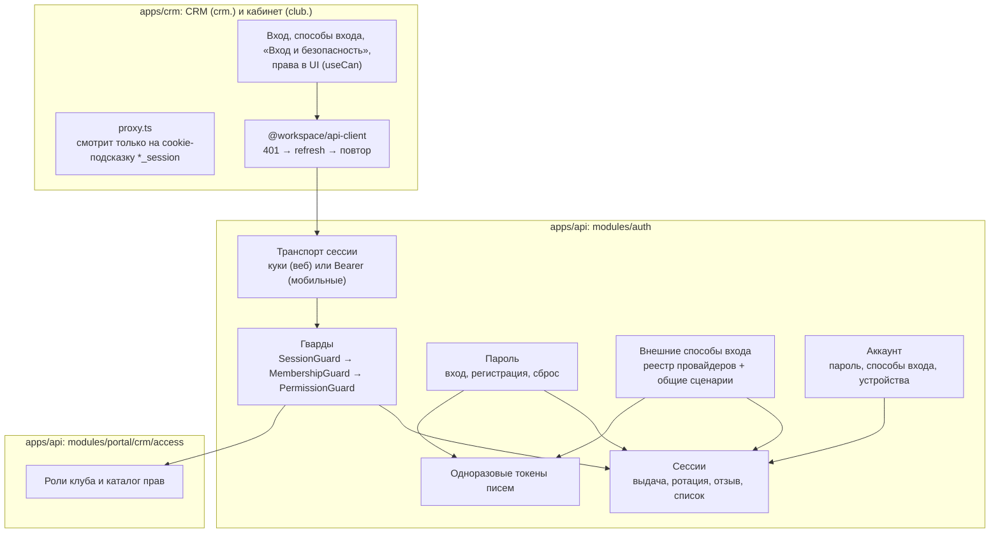
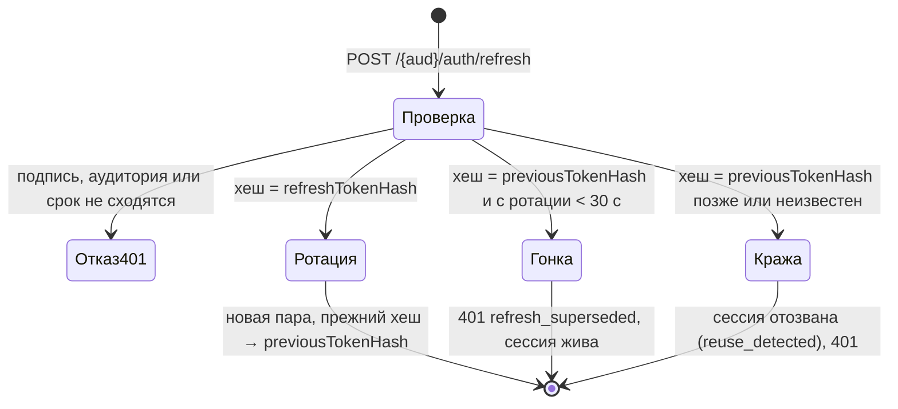
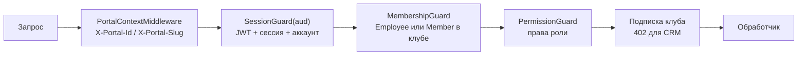
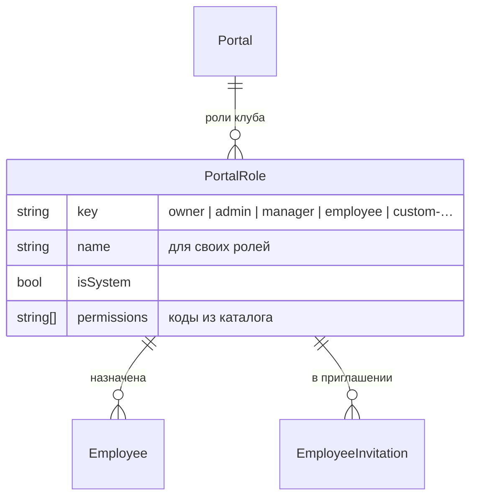
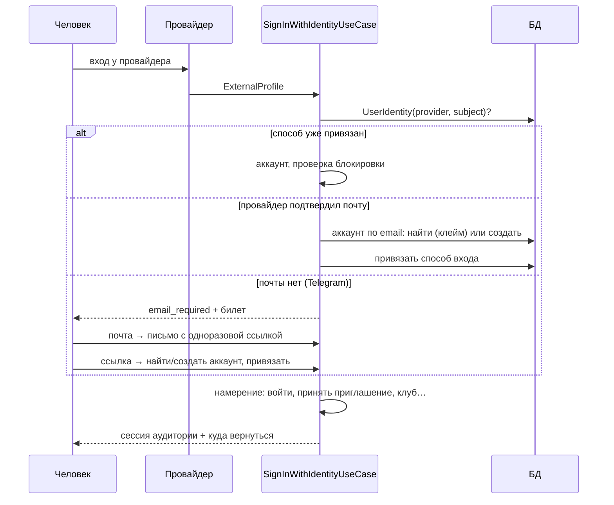

# Auth и права: целевая архитектура

Дата: 2026-10-17. План работ — [auth-platform](../tasks/auth-platform.md) (TASK-730…). Решение Вадима
(2026-10-17): «мы ещё в dev, обратная совместимость не нужна — делай сразу по уму, особенно auth; появились
Google и Telegram, может появиться ещё что-то — нужна нормальная архитектура». Существующие клубы и
участников при необходимости можно удалить; миграции пишем так, чтобы ничего не терять, если это дёшево.

Документ описывает, как устроено **после** перестройки. Что было до неё — разбор от 2026-10-17 в
[auth-platform](../tasks/auth-platform.md#как-было).

---

## 1. Термины

| Термин | Что это |
|---|---|
| **Аккаунт** (`User`) | Человек. Глобальный, без клуба: email, пароль (может не быть), статус |
| **Способ входа** | Пароль или внешний провайдер (`UserIdentity`: Google, Telegram, …) |
| **Аудитория** | Приложение, в которое человек входит: `crm` (сотрудник, `crm.`) или `cabinet` (участник, `club.`). У каждой свои куки и свои сессии: вход в CRM на компьютере клуба не открывает личный кабинет |
| **Сессия** (`AuthSession`) | Вход на одном устройстве в одну аудиторию. Её отзыв действует сразу, а не когда истечёт access-токен |
| **Членство** | Связь аккаунта с клубом: `Employee` (сотрудник) или `Member` (участник). Резолвится на каждый запрос по клубу из `X-Portal-*` |
| **Роль** (`PortalRole`) | Набор прав сотрудника в клубе. Системные: владелец, админ, менеджер, сотрудник; клуб заводит свои |
| **Право** (permission) | Код вида `orders.process`. Каталог прав — в коде, роли хранят списки кодов |

---

## 2. Слои



Правило зависимостей прежнее: API → application → domain, инфраструктура реализует контракты домена.
Сценарии (вход внешним способом, принятие приглашения, ротация) — классы `*.use-case.ts`.

---

## 3. Сессии и токены

### 3.1 Модель

`AuthSession` — одна строка на (аккаунт, аудитория, устройство). Повторный вход на том же устройстве
заменяет сессию. Устройство — `X-Device-Id` (uuid в localStorage, шлёт api-client); без заголовка сервер
выдаёт новый id.

| Поле | Зачем |
|---|---|
| `audience` | `crm` или `cabinet` |
| `refreshTokenHash` | SHA-256 действующего refresh-токена |
| `previousTokenHash`, `rotatedAt` | Прежний токен после ротации — чтобы отличить гонку вкладок от кражи |
| `signInMethod` | Чем вошли: пароль, Google, Telegram, ссылка из письма, приглашение, регистрация |
| `userAgent`, `ipAddress`, `lastUsedAt` | Список устройств в «Вход и безопасность» |
| `revokedAt`, `revokeReason` | Выход, «выйти везде», смена пароля, блокировка, повтор refresh |

### 3.2 Токены

- **Access** — JWT `{ sub, sid, aud }`, 15 минут, секрет `JWT_SECRET`. Гвард проверяет подпись,
  аудиторию **и сессию в БД** (вместе с аккаунтом — один запрос): отозванная сессия перестаёт работать сразу.
- **Refresh** — JWT `{ sub, sid, aud, typ: "refresh" }`, 7 дней, секрет `JWT_REFRESH_SECRET` (обязателен).
  Подпись проверяется, в БД хранится только хеш.

### 3.3 Ротация



Гонка — две вкладки одновременно обновили токен: вторая пришла со старым. Её запрос отклоняется, но
браузер уже получил новые куки от первой, поэтому api-client на `refresh_superseded` просто повторяет
исходный запрос. Старый токен позже окна — признак кражи: сессия гасится целиком.

### 3.4 Куки (веб)

| Кука | Домен | Path | Кто читает |
|---|---|---|---|
| `crm_access`, `cabinet_access` | только хост API | `/` | API |
| `crm_refresh`, `cabinet_refresh` | только хост API | `/{aud}/auth` | API: refresh и logout |
| `crm_session`, `cabinet_session` | `AUTH_HINT_COOKIE_DOMAIN` (`.paf-paf.app`) | `/` | `proxy.ts` CRM: есть ли смысл пускать на закрытую страницу |

Все HttpOnly, `SameSite=Lax`, `Secure` по `AUTH_COOKIE_SECURE`. Токены больше не уходят на сайт и
другие поддомены: подсказка `*_session` содержит только `1`. Проверка сессии — всегда на API; подсказка
лишь избавляет от лишнего рендера закрытой страницы без входа.

**Подделка запроса (CSRF).** `SameSite=Lax` не различает поддомены одного сайта: форма на `paf-paf.app`
ушла бы на `api.paf-paf.app` с куками. Поэтому `SessionOriginMiddleware` принимает изменяющий запрос с
кукой сессии только с фронтов из `CORS_ORIGIN` или самого API (`Origin`, без него — `Referer`), иначе
403 `origin_not_allowed`, а API принимает тело только в JSON (форма шлётся без CORS-проверки).

Мобильные клиенты: те же эндпоинты под `/{aud}/mobile/auth/*`, токены в теле ответа, на защищённых
маршрутах — `Authorization: Bearer`. Гварды принимают оба транспорта.

---

## 4. Гварды и декораторы



| Декоратор | Что значит |
|---|---|
| `@Public()` | Без сессии |
| `@CrmSession()` | Вошёл в CRM, клуб не нужен (`/crm/my-portals`, «Вход и безопасность») |
| `@CrmAuth()` | Сотрудник клуба из заголовка + подписка клуба активна |
| `@CrmAuth({ subscription: false })` | То же без проверки подписки (биллинг, инфо о клубе) |
| `@RequirePermission(P.FinanceRead, …)` | Нужны все перечисленные права. Ставится на обработчик или класс |
| `@CabinetSession()` | Вошёл в кабинет, клуб не нужен |
| `@CabinetAuth()` | Подтверждённое членство в клубе из заголовка |
| `@CurrentPrincipal()` | `{ userId, sessionId, audience, portalId?, membershipId?, roleId?, permissions }` |

Каждый маршрут объявляет доступ явно: `test/route-auth.e2e-spec.ts` обходит все маршруты приложения и
падает, если маршрут не `@Public()` и не под гвардом сессии или `@RequirePermission` стоит без
`PermissionGuard`. Он же генерирует [AUTH_ROUTES.md](AUTH_ROUTES.md).

Проверка роли в коде (`role === "admin"`) запрещена: только права, через гвард или
`principal.can(P.X)` в сценарии, когда правило зависит от данных (например, стадия нового заказа).

---

## 5. Права сотрудников

### 5.1 Модель



- Каталог прав — константа в коде (`access/domain/permissions.ts`), сгруппирован по разделам CRM. В БД —
  только списки кодов у ролей; неизвестный код при сохранении → 400.
- **Владелец** и **админ** — системные роли с полным доступом. Их права не редактируются и вычисляются
  из каталога, поэтому новое право сразу есть у них. Владелец ровно один, его нельзя назначить или снять
  через сотрудников.
- **Менеджер** и **сотрудник** — системные роли с набором по умолчанию, клуб может его менять.
- Свои роли клуб заводит в «Настройки → Роли и права».

### 5.2 Каталог (по разделам)

| Раздел | Права |
|---|---|
| Участники | `members.read`, `members.create`, `members.edit`, `members.documents` (сканы и подпись), `members.invite` (ссылки регистрации) |
| Заказы | `orders.read`, `orders.create`, `orders.process` (стадии, статус, оплата, стадия при создании) |
| Каталог | `catalog.manage` (товары, категории, единицы; чтение каталога — у всех) |
| Финансы | `finance.read`, `finance.write` |
| Присутствие | `presence.read` (визиты, статистика), `presence.checkin` (скан, ручной вход/выход), `qr.manage` (выпуск и отзыв QR) |
| Смарт-процессы | `records.read`, `records.write`, `records.delete` |
| Команда | `employees.read`, `employees.manage` (добавить, изменить, отключить, приглашения), `roles.manage` |
| Клуб | `settings.club` (правила клуба, присутствие, оформление, публичная страница), `settings.structure` (сущности, поля, формы, воронки, статусы), `settings.views` (общие для клуба виды списков и канбана), `billing.manage` |

Набор по умолчанию: **менеджер** — прежние границы роли: всё, кроме `members.invite`, `catalog.manage`,
`records.delete`, `finance.write`, `employees.manage`, `roles.manage`, `settings.club`, `settings.structure`,
`billing.manage` (общие виды `settings.views` у него есть); **сотрудник** — `members.read`, `members.create`, `orders.read`,
`orders.create`, `presence.read`, `presence.checkin`, `records.read`. Финансы, сканы документов,
список команды и QR у сотрудника по умолчанию закрыты.

### 5.3 Правила назначения

- Назначать роль и менять её права может тот, у кого `employees.manage` / `roles.manage`, и только если
  все права этой роли есть у него самого: так менеджер не выдаст себе или другому больше, чем имеет.
- Нельзя менять себя и владельца; нельзя трогать сотрудника, чья роль шире прав действующего.

### 5.4 Фронт

`GET /crm/auth/me` отдаёт по каждому клубу роль и права. `useCan(P.X)` прячет кнопки, пункты меню и
разделы настроек; страница без права показывает «Нет доступа», а не ловит 403 из запросов.

---

## 6. Способы входа

### 6.1 Провайдеры

Код — `modules/portal/auth/identity`. Провайдер — адаптер с общим контрактом, сценарии о конкретных
провайдерах не знают:

```ts
interface IdentityProviderBase {
    key: IdentityProviderKey;                        // "google" | "telegram" = enum IdentityProvider в БД
    isEnabled(audience): boolean;                    // ключи заданы для этой аудитории
    publicConfig(audience): ProviderPublicConfig;    // что нужно кнопке: { botUsername, botId } и т. п.
}
interface RedirectIdentityProvider extends IdentityProviderBase {  // Google
    flow: "redirect";
    authorizationUrl({ redirectUri, state, nonce, codeChallenge }): string;
    exchange({ code, redirectUri, codeVerifier, nonce }): Promise<ExternalProfile>; // сверяет nonce
}
interface WidgetIdentityProvider extends IdentityProviderBase {    // Telegram
    flow: "widget";
    verify(audience, payload): ExternalProfile;       // проверяет подпись ответа виджета
}
interface ExternalProfile {
    provider; subject; email | null; emailVerified; displayName; givenName; familyName; username; locale;
}
```

`IdentityProviderRegistry` собирает адаптеры (DI-токен `IDENTITY_PROVIDERS`) и раздаёт их маршрутам по ключу:
неизвестный ключ — 404 `identity_unknown`, не настроенный для аудитории или не того вида — 503 `{provider}_off`.
State, кука привязки и PKCE редирект-входа — общий `OAuthRedirectFlowService` (state подписан ключом,
производным от `JWT_SECRET`, и привязан к аудитории и провайдеру).

**Новый провайдер** = адаптер в `identity/infrastructure/<provider>/`, строка в `IDENTITY_PROVIDERS`
(`identity.module.ts`), значение в `IDENTITY_PROVIDER_KEYS` и в enum `IdentityProvider` схемы (миграция),
адрес возврата `{API}/{aud}/auth/{provider}/callback` у провайдера и кнопка на фронте. Маршруты, сценарии,
сессии и «Вход и безопасность» трогать не нужно.

Telegram настраивается на аудиторию: Telegram Login привязан к одному домену бота (`/setdomain`), поэтому
у кабинета бот `TG_CLIENT_BOT_*` (club.), у CRM — свой необязательный `TG_CRM_BOT_*` (crm.); без него
кнопки Telegram в CRM нет.

### 6.2 Маршруты

| Маршрут | Что делает |
|---|---|
| `GET /{aud}/auth/providers` | Включённые провайдеры и их публичные параметры |
| `GET /{aud}/auth/{provider}/start?locale&returnTo&intent&token` | Редирект-провайдер: к провайдеру, кука `oauth_flow` на `/{aud}/auth/{provider}` |
| `GET /{aud}/auth/{provider}/link` | То же для аккаунта сессии (`intent=link`), возврат на «Вход и безопасность» |
| `GET /{aud}/auth/{provider}/callback` | Возврат от провайдера: сессия и редирект; отказ — `/auth/login?error={provider}_auth` |
| `POST /{aud}/auth/{provider}/verify` `{ payload }` | Виджет: `signed_in` (куки) или `email_required` + билет |
| `POST /{aud}/auth/identity/email` `{ ticket, email }` | Шаг «укажите почту»: одноразовая ссылка (`identity_email_link`) |
| `POST /{aud}/auth/identity/confirm` `{ token }` | Ссылка из письма: найти/завести аккаунт, привязать, сессия |
| `GET /{aud}/account/security` | Пароль и способы входа (`methods[]`: provider, flow, available, linked, email, username) |
| `PUT /{aud}/account/security/password` | Задать/сменить пароль; остальные сессии отзываются |
| `POST /{aud}/account/security/{provider}` `{ payload }` | Привязать виджет-провайдера |
| `DELETE /{aud}/account/security/{provider}` | Отвязать; последний способ — 409 `last_sign_in_method` |
| `POST /{aud}/account/security/sign-out-everywhere` | Отозвать все сессии аккаунта |
| `/{aud}/account/sessions` | Устройства (§3) |

Намерения (`intent`, едут в подписанном state): без намерения — вход; `link` (аккаунт из сессии на старте),
`invitation` (CRM: принять приглашение, адрес провайдера = адрес приглашения), `club_signup` (CRM: на «Новый
клуб»). Завершение редиректа у аудиторий своё: `CabinetIdentitySignInService`, `CrmIdentitySignInService`.

Коды отказов: `{provider}_off | _signature | _unverified | _taken | _other_linked`, общие — `identity_unknown`,
`identity_ticket`, `identity_link`, `account_blocked`, `account_gone`. Исход привязки редиректом — параметр по
имени провайдера на странице безопасности: `?google=linked` или код отказа.

### 6.3 Общий сценарий входа



Почта, подтверждённая провайдером или ссылкой из письма, — доказательство владения адресом: аккаунт,
заведённый клубом (`pending_claim`), клеймится, его неподтверждённый пароль сбрасывается, сессии
отзываются. Один способ на провайдера на аккаунт (`@@unique([userId, provider])`); чужой способ не
перепривязывается.

---

## 7. Одноразовые токены писем

`AuthToken { purpose, userId? | email?, tokenHash, payload, expiresAt, consumedAt }` вместо колонок в `User` и
stateless-JWT в ссылках:

| purpose | Срок | Что делает |
|---|---|---|
| `email_verification` | 24 ч | Подтвердить почту |
| `password_reset` | 1 ч | Задать новый пароль |
| `account_setup` | 7 дней | Аккаунт, заведённый клубом: задать пароль (клейм) |
| `identity_email_link` | 24 ч | Провайдер без почты: подтвердить адрес и привязать способ входа |

`issue` гасит прежние неиспользованные токены той же цели и адресата, `consume` атомарно ставит `consumedAt` —
ссылка работает один раз; форма пароля принимает и `password_reset`, и `account_setup`. Смена пароля гасит
ссылки сброса, клейм аккаунта — ссылку подтверждения. Ночной cron удаляет истёкшие и погашенные больше месяца
назад (`modules/portal/auth/tokens`). В БД — SHA-256. Токены согласия на членство и приглашений остаются в своих таблицах
(это сущности со своим жизненным циклом), тоже хешем.

---

## 8. Регистрация и защита от перебора

- Регистрация участника на занятый email отвечает так же, как на новый (`{ email, awaitingEmailConfirmation }`,
  без id), а владельцу адреса уходит письмо «вы уже зарегистрированы — войдите или восстановите пароль».
  Пароль хешируется и в этой ветке: по времени ответа адрес тоже не отличить.
- Регистрация клуба на занятый email — 409 с предложением войти: владелец клуба входит сразу после
  регистрации (решение 2026-10-14), а одинаковый ответ этого не позволяет. Риск перебора здесь принят
  осознанно: форма B2B, под общим лимитом регистраций.
- Вход: кроме лимита по IP, неудачные попытки считаются по email в Redis (`PasswordSignInService`) — после
  `LOGIN_MAX_FAILURES` (10) за `LOGIN_FAILURE_WINDOW_SECONDS` (15 минут) вход паролем этим адресом закрыт до
  конца окна при любом IP (429 `too_many_attempts`); Google, Telegram и сброс пароля работают. Неизвестный
  адрес сравнивается с хешем-заглушкой — время ответа одно. Redis недоступен — счётчик пропускается.
- Ответ «почта не подтверждена» — только после верного пароля.

---

## 9. Фронт

- `proxy.ts` смотрит на `crm_session` / `cabinet_session`, а не на токены.
- api-client только на куках (`credentials: include`), токены в JS не попадают: refresh по аудитории,
  `refresh_superseded` → повтор исходного запроса.
- Общие куски вместо копий CRM/кабинета: правило пароля, формы «забыли пароль» и «новый пароль»,
  подтверждение почты, плашка ошибки, безопасный `from`, «me или null на 401», провайдер-гвард сессии.
- `SignInMethods` рисует кнопки по `GET /{aud}/auth/providers` из реестра `{ google, telegram }`.
- «Вход и безопасность» — общий виджет `widgets/account-security` в CRM (`/{язык}/account/security`) и
  кабинете (`/{язык}/me`): пароль, способы входа, устройства (сессии с отзывом), выход везде. Приложение
  даёт клиента (`crmAccountSecurity` / `cabinetAccountSecurity`) через `AccountSecurityContext`.
